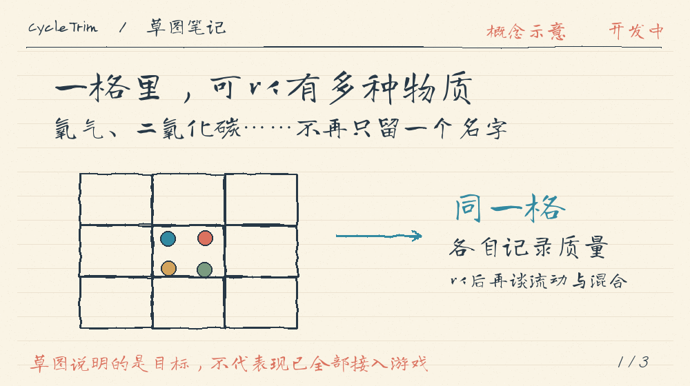

# Hand-drawn GIF Explainer

Create short looping explanations that look like notes on paper: hand-drawn lines, handwriting, a restrained palette and motion that helps tell the story. Includes a reusable Codex skill and a configurable Pillow renderer.

用手写草图讲清一个概念、流程或架构。支持中英文与自定义字体；生成后应逐幕检查文字、画面和动画。



The example illustrates an experimental design; it is not a claim that the depicted system is finished.

## Install the skill

Clone this repository, then copy or link its `handdrawn-gif-explainer/` directory into `~/.codex/skills/handdrawn-gif-explainer`. For a live link from a clone:

```sh
mkdir -p ~/.codex/skills
ln -s "$(pwd)/handdrawn-gif-explainer" ~/.codex/skills/handdrawn-gif-explainer
```

Run these commands from the clone root. Do not replace an existing skill without checking it first. Restart or refresh the skill list if your client has already cached it. Invoke `$handdrawn-gif-explainer` or ask for a hand-drawn GIF explainer.

## Renderer

The renderer requires Python 3 and [Pillow](https://pillow.readthedocs.io/). Inspect its current schema and options with:

```sh
python3 -m pip install -r requirements.txt
python3 handdrawn-gif-explainer/scripts/render.py examples/story.json /tmp/story.gif --font /path/to/handwriting-font.ttf
python3 handdrawn-gif-explainer/scripts/render.py --help
```

The UTF-8 JSON example contains an array of scenes. Each scene can use `grid`, `parallel` or `flow`, with its own title, subtitle and labels. Width, height, frames per scene and frame duration are shared. A single scene can also be supplied directly at the JSON root. Existing outputs are not overwritten.

Use a font with coverage for the intended language. Handwriting fonts are not bundled; verify the font license before redistribution. The renderer is a starting point rather than a required visual template. Adapt the storyboard, typography and animation to the subject, and inspect every scene at the size it will be shown.

## License

Code and skill instructions are MIT licensed; see [LICENSE](LICENSE). Fonts and third-party assets are not included in that grant.
